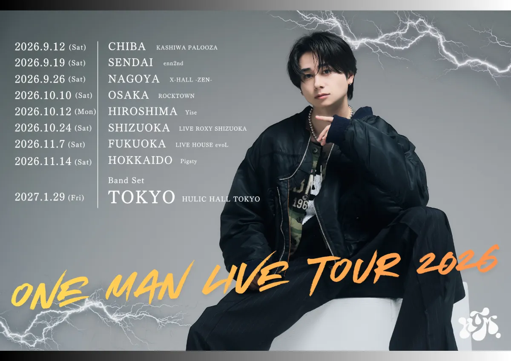

<!DOCTYPE html>
<html lang="ja" class="dark">
<head>
  <meta charset="UTF-8" />
  <meta name="viewport" content="width=device-width, initial-scale=1.0" />
  <title>HASETOMO. ONE MAN LIVE TOUR 2026 ~ REVOLUTION ~ | チケット・公演情報まとめ</title>
  <meta name="description" content="HASETOMO. ONE MAN LIVE TOUR 2026 ~ REVOLUTION ~ の各種プレイガイド（イープラス・ローチケ・チケットぴあ）および全国公演スケジュールまとめページです。" />

  <!-- Google Fonts: ツアービジュアルに合わせた力強い欧文と視認性の高い和文フォント -->
  <link rel="preconnect" href="https://fonts.googleapis.com" />
  <link rel="preconnect" href="https://fonts.gstatic.com" crossorigin />
  <link href="https://fonts.googleapis.com/css2?family=Montserrat:ital,wght@0,600;0,800;0,900;1,800&family=Noto+Sans+JP:wght@400;500;700;900&family=Oswald:wght@500;700&display=swap" rel="stylesheet" />

  <!-- Tailwind CSS -->
  
  

  
</head>
<body class="bg-street-grid min-h-screen flex flex-col items-center antialiased selection:bg-brand-orange selection:text-black">

  <!-- 背景の稲妻SVGデコレーション -->
  

    <svg class="absolute -top-12 -right-16 w-96 h-96 text-white/10 lightning-accent" viewBox="0 0 200 200" fill="none">
      <path d="M120 10L65 95H110L85 190L155 85H105L120 10Z" stroke="currentColor" stroke-width="0.75" />
    </svg>
    <svg class="absolute bottom-10 -left-20 w-80 h-80 text-brand-orange/10 lightning-accent" style="animation-delay: 1.5s;" viewBox="0 0 200 200" fill="none">
      <path d="M90 15L40 105H85L65 185L135 85H90L90 15Z" stroke="currentColor" stroke-width="0.75" />
    </svg>
  

  <!-- メインコンテナ（スマホ閲覧に最適化しつつPCでも美しく表示） -->
  <main class="relative z-10 w-full max-w-xl mx-auto px-4 pt-4 pb-16 sm:pt-8">

    <!-- ヒーローセクション：TOP画像 & ツアータイトル -->
    <header class="relative rounded-2xl overflow-hidden bg-zinc-900 border border-zinc-800/90 shadow-2xl shadow-black/80">
      <!-- キービジュアル画像エリア -->
      

        

        <!-- 画像ローカル未配置時のフォールバック表示（通常時は非表示） -->
        

          

            <svg class="w-6 h-6" fill="none" stroke="currentColor" viewBox="0 0 24 24">
              <path stroke-linecap="round" stroke-linejoin="round" stroke-width="2" d="M4 16l4.586-4.586a2 2 0 012.828 0L16 16m-2-2l1.586-1.586a2 2 0 012.828 0L20 14m-6-6h.01M6 20h12a2 2 0 002-2V6a2 2 0 00-2-2H6a2 2 0 00-2 2v12a2 2 0 002 2z" />
            </svg>
          

          
HASETOMO. ONE MAN LIVE TOUR 2026

          
同一フォルダに <code class="text-brand-orange bg-black/50 px-1.5 py-0.5 rounded">はせとも2026ツアー横.webp</code> を配置すると表示されます

          <label class="mt-3 cursor-pointer inline-flex items-center gap-1.5 px-3 py-1.5 rounded-lg bg-zinc-800 hover:bg-zinc-700 border border-zinc-600 text-xs font-medium text-zinc-200 transition">
            プレビュー用に画像を選択
            <input type="file" accept="image/*" class="hidden" onchange="previewLocalFile(event)" />
          </label>
        

        <!-- 下部グラデーションブレンド -->
        

      

      <!-- イベントタイトル＆概要ヘッダー -->
      

        

          
          OFFICIAL TICKET HUB
        

        <h1 class="font-display font-black text-2xl sm:text-3xl tracking-tight text-white leading-tight">
          HASETOMO.
          
            ONE MAN LIVE TOUR 2026
          
          
            ~ REVOLUTION ~
          
        </h1>
      

    </header>

    <!-- チケットプレイガイド リンクセクション -->
    <section aria-labelledby="tickets-heading" class="mt-7">
      

        

          
          <h2 id="tickets-heading" class="font-display font-extrabold text-base sm:text-lg tracking-wider text-white uppercase">
            TICKETS チケット購入
          </h2>
        

        外部サイトへ移動します
      

      

        <!-- 1. イープラス (e+) -->
        <a
          href="https://eplus.jp/sf/detail/4369350001"
          target="_blank"
          rel="noopener noreferrer"
          class="ticket-card group block rounded-2xl bg-gradient-to-r from-[#16161b] to-[#1b1519] border border-zinc-800 hover:border-[#eb0065]/70 p-4 sm:p-5 shadow-lg hover:shadow-[0_8px_30px_rgba(235,0,101,0.18)]"
        >
          <!-- ホバー時のシマー光沢 -->
          

          

            

              <!-- e+ バッジアイコン -->
              

                e+
              

              

                

                  イープラス
                  eplus
                

                
チケット申し込み・詳細はこちら

              

            

            <!-- 外部リンク矢印ボタン -->
            

              <svg class="w-4 h-4 transform group-hover:translate-x-0.5 group-hover:-translate-y-0.5 transition-transform" fill="none" stroke="currentColor" viewBox="0 0 24 24">
                <path stroke-linecap="round" stroke-linejoin="round" stroke-width="2.2" d="M7 17L17 7M17 7H8M17 7V16" />
              </svg>
            

          

        </a>

        <!-- 2. ローチケ (Lawson Ticket) -->
        <a
          href="https://l-tike.com/concert/mevent/?mid=797133"
          target="_blank"
          rel="noopener noreferrer"
          class="ticket-card group block rounded-2xl bg-gradient-to-r from-[#16161b] to-[#131822] border border-zinc-800 hover:border-[#0068b7]/80 p-4 sm:p-5 shadow-lg hover:shadow-[0_8px_30px_rgba(0,104,183,0.22)]"
        >
          

          

            

              <!-- ローチケ バッジアイコン -->
              

                L-tike
              

              

                

                  ローチケ
                  LAWSON TICKET
                

                
ローソンチケット 公演ページへ

              

            

            

              <svg class="w-4 h-4 transform group-hover:translate-x-0.5 group-hover:-translate-y-0.5 transition-transform" fill="none" stroke="currentColor" viewBox="0 0 24 24">
                <path stroke-linecap="round" stroke-linejoin="round" stroke-width="2.2" d="M7 17L17 7M17 7H8M17 7V16" />
              </svg>
            

          

        </a>

        <!-- 3. チケットぴあ (Ticket Pia) -->
        <a
          href="https://t.pia.jp/pia/event/event.do?eventBundleCd=b2671909"
          target="_blank"
          rel="noopener noreferrer"
          class="ticket-card group block rounded-2xl bg-gradient-to-r from-[#16161b] to-[#121c21] border border-zinc-800 hover:border-[#0099d9]/80 p-4 sm:p-5 shadow-lg hover:shadow-[0_8px_30px_rgba(0,153,217,0.2)]"
        >
          

          

            

              <!-- チケットぴあ バッジアイコン -->
              

                PIA
              

              

                

                  チケットぴあ
                  TICKET PIA
                

                
チケットぴあ 公演ページへ

              

            

            

              <svg class="w-4 h-4 transform group-hover:translate-x-0.5 group-hover:-translate-y-0.5 transition-transform" fill="none" stroke="currentColor" viewBox="0 0 24 24">
                <path stroke-linecap="round" stroke-linejoin="round" stroke-width="2.2" d="M7 17L17 7M17 7H8M17 7V16" />
              </svg>
            

          

        </a>
      

    </section>

    <!-- ツアースケジュール一覧セクション（画像記載の全9公演） -->
    <section aria-labelledby="schedule-heading" class="mt-9">
      

        

          
          <h2 id="schedule-heading" class="font-display font-extrabold text-base sm:text-lg tracking-wider text-white uppercase">
            TOUR SCHEDULE 公演日程
          </h2>
        

        ALL 9 SHOWS
      

      

        <!-- 1. CHIBA (公演終了) -->
        

          

            

              2026.9.12
              (Sat)
            

            
              公演終了
            
          

          

            CHIBA
            KASHIWA PALOOZA
          

        

        <!-- 2. SENDAI (公演終了) -->
        

          

            

              2026.9.19
              (Sat)
            

            
              公演終了
            
          

          

            SENDAI
            enn2nd
          

        

        <!-- 3. NAGOYA (公演終了) -->
        

          

            

              2026.9.26
              (Sat)
            

            
              公演終了
            
          

          

            NAGOYA
            X-HALL -ZEN-
          

        

        <!-- 4. OSAKA (公演終了) -->
        

          

            

              2026.10.10
              (Sat)
            

            
              公演終了
            
          

          

            OSAKA
            ROCKTOWN
          

        

        <!-- 5. HIROSHIMA (公演終了) -->
        

          

            

              2026.10.12
              (Mon)
            

            
              公演終了
            
          

          

            HIROSHIMA
            Yise
          

        

        <!-- 6. SHIZUOKA (公演終了) -->
        

          

            

              2026.10.24
              (Sat)
            

            
              公演終了
            
          

          

            SHIZUOKA
            LIVE ROXY SHIZUOKA
          

        

        <!-- 7. FUKUOKA (公演終了) -->
        

          

            

              2026.11.7
              (Sat)
            

            
              公演終了
            
          

          

            FUKUOKA
            LIVE HOUSE evoL
          

        

        <!-- 8. HOKKAIDO (公演終了) -->
        

          

            

              2026.11.14
              (Sat)
            

            
              公演終了
            
          

          

            HOKKAIDO
            Pigsty
          

        

        <!-- 9. TOKYO (Band Set / TOUR FINAL) -->
        

          

            
              BAND SET
            
            

              2027.1.29
              (Fri)
            

          

          

            TOKYO
            HULIC HALL TOKYO
          

        

      

    </section>

    <!-- シェア / URLコピー アクション -->
    

      <button
        type="button"
        onclick="copyPageUrl()"
        class="inline-flex items-center gap-2 px-5 py-2.5 rounded-full bg-zinc-900 hover:bg-zinc-800 active:scale-95 border border-zinc-700/80 text-xs font-medium text-zinc-300 hover:text-white transition-all shadow-md"
      >
        <svg class="w-4 h-4 text-brand-orange" fill="none" stroke="currentColor" viewBox="0 0 24 24">
          <path stroke-linecap="round" stroke-linejoin="round" stroke-width="2" d="M8 16H6a2 2 0 01-2-2V6a2 2 0 012-2h8a2 2 0 012 2v2m-6 12h8a2 2 0 002-2v-8a2 2 0 00-2-2h-8a2 2 0 00-2 2v8a2 2 0 002 2z" />
        </svg>
        このページのURLをコピーしてシェア
      </button>
    

    <!-- フッター -->
    <footer class="mt-10 pt-6 border-t border-zinc-800/70 text-center">
      

        HASETOMO. ONE MAN LIVE TOUR 2026 ~ REVOLUTION ~
      

      

        &copy; 2026 HASETOMO. All Rights Reserved.
      

    </footer>
  </main>

  <!-- トースト通知（URLコピー完了時） -->
  

    

      <svg class="w-4 h-4 text-brand-orange shrink-0" fill="none" stroke="currentColor" viewBox="0 0 24 24">
        <path stroke-linecap="round" stroke-linejoin="round" stroke-width="2.5" d="M5 13l4 4L19 7" />
      </svg>
      URLをクリップボードにコピーしました
    

  

  
</body>
</html>
